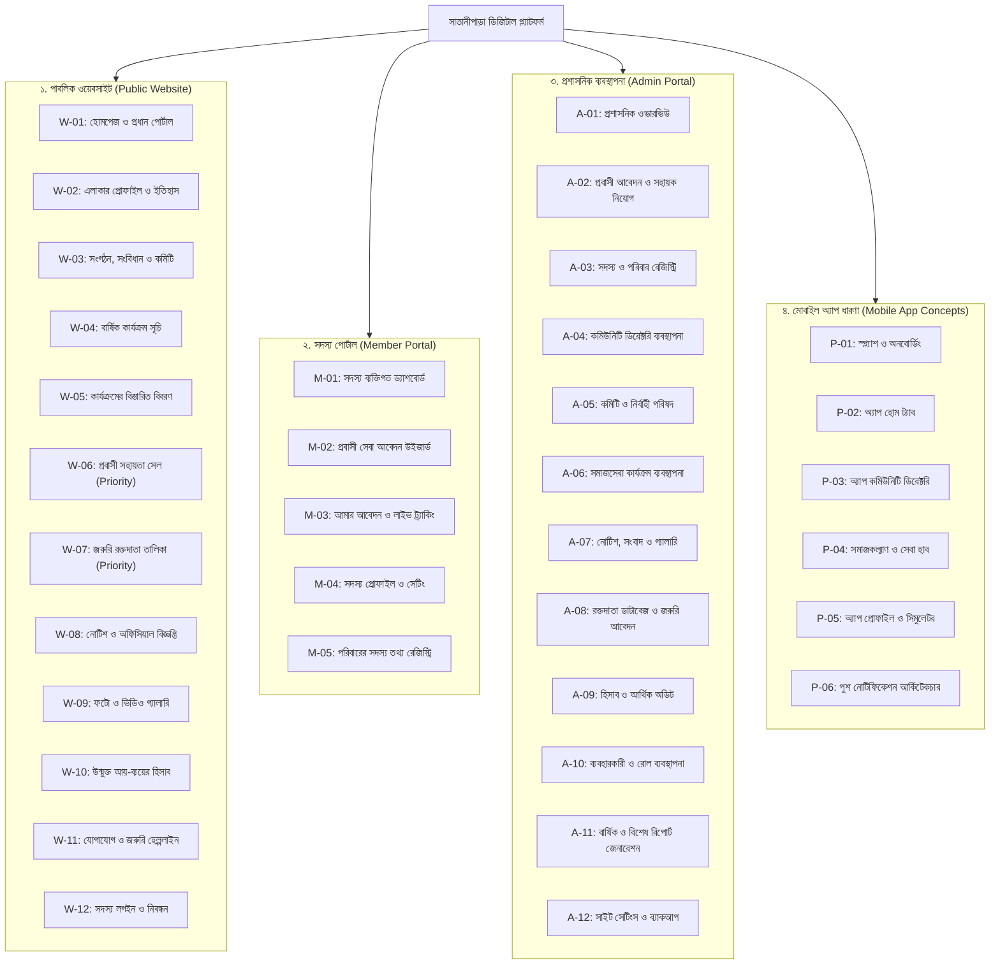

# Direction D: Complete Information Architecture & Sitemap

**Project:** Satanipara Somaj Kallyan Sangha  
**Branch:** `direction-d-premium-rebuild`  
**Total Screens:** 35 Screens (12 Public, 5 Member, 12 Admin, 6 Mobile App)  
**Total Interactive Flows:** 8 User Journeys (F-01 through F-08)  

---

## 1. Information Architecture Overview

---

## 2. Navigation Taxonomy & Structural Pacing

1. **Top Announcement Strip:** High-priority notices, live blood emergency tickers, and instant language switch (BN/EN).
2. **Masthead (60px sticky):** Civic crest emblem, bilingual organization title, categorized desktop menu, theme toggle, and mobile sheet trigger.
3. **Categorized Mobile Navigation Drawer:**
   - **মূল সংগঠন ও এলাকা:** হোম, এলাকার প্রোফাইল, সংগঠন ও সংবিধান, বার্ষিক কার্যক্রম.
   - **জনকল্যাণ ও সেবাসমূহ:** প্রবাসী সহায়তা সেল, জরুরি রক্তদাতা তালিকা, নোটিশ ও সংবাদ.
   - **স্বচ্ছতা ও যোগাযোগ:** উন্মুক্ত হিসাব ও অডিট, ফটো গ্যালারি, যোগাযোগ ও জরুরি নম্বর.
   - **অ্যাকশন ফুটার:** সদস্য ড্যাশবোর্ড ও লগইন/নিবন্ধন সরাসরি বাটন.
4. **Interactive Prototype HUD:** Non-intrusive floating control (`#hudToggleBtn`) enabling instant switching between all 35 screens without breaking immersion.
